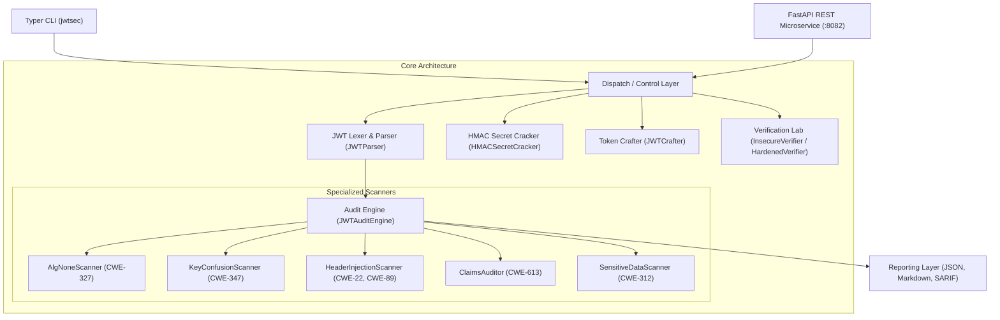

# Architecture Documentation: JWT Security Analyzer (`jwtsec`)

## 1. System Overview

`jwtsec` is an automated, high-assurance JSON Web Token (JWT) vulnerability analyzer, cracker, token crafter, and verification lab. It enables security researchers, penetration testers, and DevSecOps engineers to audit tokens against known cryptographic and RFC implementation vulnerabilities, test token validation pipelines, and recover weak HMAC signing secrets.

## 2. Component Breakdown

### 2.1 Lexer, Parser & Normalizer (`jwtsec.core.parser`)
- Splits standard 3-part or 2-part tokens.
- Handles base64url unpadding and padding restoration.
- Enforces payload bounds (16KB max length protection against DoS).
- Extracts raw bytes, JSON header, and JSON payload safely without verifying signatures during parsing.

### 2.2 Security Scanners (`jwtsec.scanners`)
- **`AlgNoneScanner`**: Identifies algorithm confusion vulnerabilities including casing anomalies (`none`, `None`, `NONE`, `nOnE`), empty signature segments, and mismatched signing signatures.
- **`KeyConfusionScanner`**: Detects asymmetric-to-symmetric key confusion where an RSA or EC public key is passed to verify an HMAC token.
- **`HeaderInjectionScanner`**: Detects dangerous header parameters including `kid` traversal (`../`), command injection, SQL injection, rogue JWK parameter injection (`jwk`), and untrusted URI parameters (`jku`, `x5u`).
- **`ClaimsAuditor`**: Verifies temporal claims (`exp`, `nbf`, `iat`), clock skew leeways, missing expiration, and excessively long-lived session lifetimes.
- **`SensitiveDataScanner`**: Scans unencrypted claims for credentials, passwords, session secrets, API tokens, credit cards, SSNs, and AWS/cloud keys using regex pattern recognition.

### 2.3 Cracking Engine (`jwtsec.core.cracker`)
- High-performance, vectorized HMAC-SHA256/384/512 dictionary verification.
- Re-hashes candidate secrets against the raw header-payload pre-computed message block.
- Supports custom wordlists and integrated high-frequency weak JWT secret collections.

### 2.4 Token Crafter (`jwtsec.core.crafter`)
- Generates proof-of-concept and unit-testing tokens:
  - `none` tokens with customizable casing and empty or arbitrary signatures.
  - HMAC-signed tokens with arbitrary secrets and headers.
  - RSA-signed tokens with PEM private keys.
  - Header-injected tokens for penetration testing verification.

### 2.5 Dual-Mode Verification Lab (`jwtsec.lab.verifier`)
- **InsecureVerifier**: Simulates vulnerable legacy authentication logic susceptible to `alg: none` stripping and asymmetric public-key HMAC confusion.
- **HardenedVerifier**: Implements zero-trust token validation with strict algorithm whitelisting, explicit key binding, and mandatory expiration validation.

### 2.6 Multi-Format Reporters (`jwtsec.reporters`)
- Produces clean terminal outputs, machine-readable JSON, GitHub Flavored Markdown security reports, and OASIS SARIF v2.1.0 for CI/CD pipeline integration.
